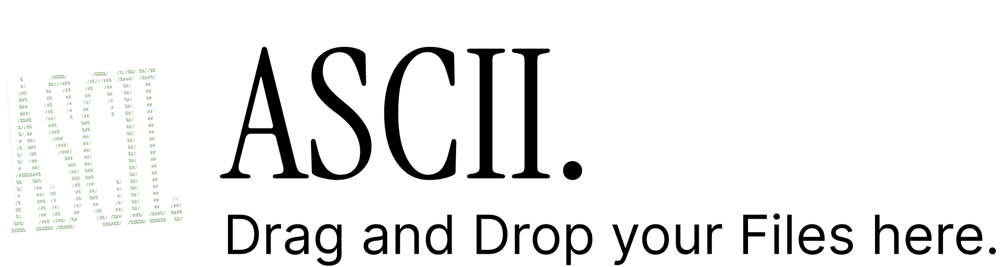
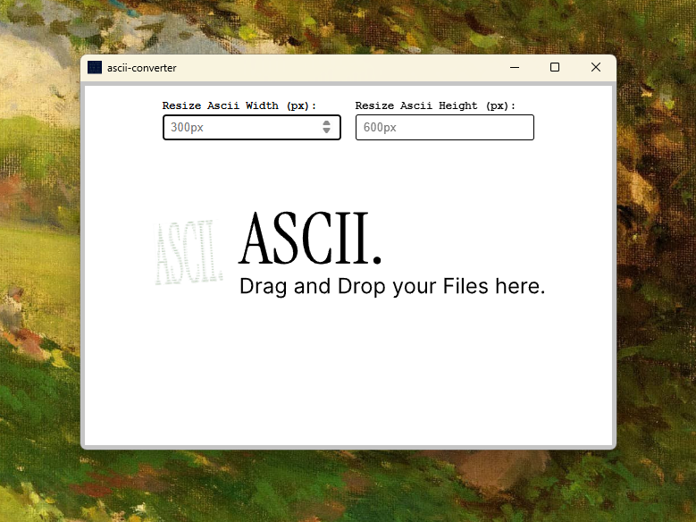

<p align="center">
  
</p>

# ASCII Converter

A lightweight desktop application that converts images into ASCII art through a simple drag-and-drop interface, saving the result as an executable Bash script (`.sh`).

ASCII Converter was built with **Rust and Tauri** as a small experiment in image processing, pixel luminosity, and generating text-based representations of images.

## Why I Built It

I originally started this project while learning **Rust and Tauri**, experimenting with native desktop applications and local file processing.

The project eventually evolved into an image-to-ASCII converter, exploring how individual pixels and their brightness values can be represented using a limited set of characters.

The main goals were simple:

- Keep the workflow straightforward with drag-and-drop functionality.
- Process images entirely locally without uploading them to external services.
- Generate ASCII art that can be displayed directly in a terminal.
- Explore image processing and file generation using Rust.

## Application

<p align="center">
  
</p>

Using the application is intentionally simple:

1. Open ASCII Converter.
2. Drag and drop an image into the application window.
3. The image is decoded and converted into ASCII characters based on pixel luminosity.
4. The generated ASCII art is embedded in a `.sh` file and saved in the same directory as the original image.

For example:

```text
photo.png
    ↓
photo.sh
```

Running the generated script in a Bash-compatible terminal prints the ASCII representation of the original image.

The original image remains unchanged.

## How It Works

ASCII Converter uses a small Tauri frontend for file interaction and a Rust backend for image processing and ASCII generation.

```text
               ASCII Converter
                      │
              Drag-and-drop Image
                      │
                      ▼
              JavaScript Frontend
                      │
                 Tauri Command
                      │
                      ▼
                 Rust Backend
                      │
                 Decode Image
                      │
                      ▼
                Read Pixel Data
                      │
                      ▼
              Luminosity Mapping
                      │
                      ▼
                ASCII Generation
                      │
                      ▼
               Generate .sh File
                      │
                      ▼
             Save Next to Original
```

The frontend listens for Tauri drag-and-drop events and passes the selected image path to the Rust backend.

Rust uses the `image` crate to decode the image and `image_ascii` to generate its ASCII representation.

The ASCII generator uses a small character set:

```rust
['.', '/', '%', '#']
```

Each character represents a different level of brightness, allowing the image to be reconstructed as text.

The resulting ASCII art is embedded in a Bash script using a heredoc, allowing it to be printed directly to the terminal when executed.

All processing happens locally without external executables or online services.

## Supported Formats

The image decoder is configured to support:

| Type | Formats |
| --- | --- |
| Images | `.png`, `.jpg`, `.jpeg` |
| Output | `.sh` |

The generated Bash script contains the ASCII representation of the image.

## Tech Stack

**Desktop application:** Tauri 2  
**Backend:** Rust  
**Frontend:** HTML, CSS, JavaScript  
**Image decoding:** `image` crate  
**ASCII generation:** `image_ascii` crate

No FFmpeg, Ghostscript, or external media-processing tools are required.

## Project Structure

```text
ascii-converter/
├── assets/
│   ├── front.svg
│   └── UI.png
│
├── src/
│   ├── main.js
│   └── ...
│
├── src-tauri/
│   ├── src/
│   │   ├── main.rs
│   │   └── lib.rs
│   │
│   ├── Cargo.toml
│   └── tauri.conf.json
│
├── package.json
└── README.md
```

Most of the application logic is divided between drag-and-drop handling in the JavaScript frontend and image processing in the Rust backend.

## Running From Source

The project requires a working Rust and Node.js environment with the system dependencies required by Tauri.

Clone the repository:

```bash
git clone <repository-url> ascii-converter
cd ascii-converter
```

Install the JavaScript dependencies:

```bash
npm install
```

Run the application in development mode:

```bash
npm run tauri dev
```

Build a release version:

```bash
npm run tauri build
```

The generated application and installers can be found inside:

```text
src-tauri/target/release/bundle/
```

## Current Status

ASCII Converter currently focuses on converting images into ASCII art and generating Bash scripts containing the result.

The application is developed and tested on **Windows**. Generated `.sh` files require a Bash-compatible environment, such as Linux, macOS, Git Bash, or WSL, to execute.

All image processing is handled locally in Rust, without uploading files or invoking external compression tools.

The project remains a small learning experiment exploring **Rust, Tauri, image processing, and text-based image representation**.
